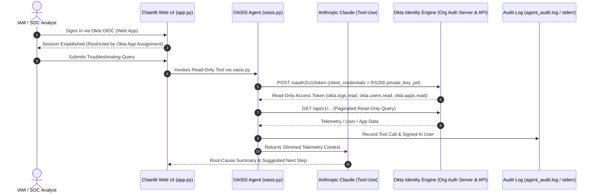

# OASIS

**Okta Access Security Intelligence System**

A read-only Okta troubleshooting assistant. Ask it a question in plain English ("why is jdoe@example.com failing to sign in today?") and it queries your Okta org through Claude tool calls, then summarizes what happened, the pattern, the likely cause and a suggested next step.

It cannot change anything in Okta. It only requests read scopes and only makes GET calls.

## What it can look up

| Tool | What it does |
| --- | --- |
| `search_logs` | Searches the System Log (up to 7 days back), auto-paginates, and returns totals and breakdowns by event, result, reason, user, IP, country and app, plus a sample of recent events |
| `get_user_status` | Account state (ACTIVE, LOCKED_OUT, SUSPENDED, ...) and key timestamps |
| `get_user_authenticators` | Enrolled factors and their status (types only, no phone numbers or emails) |
| `find_apps` | Finds app integrations by label |
| `get_user_apps` | Apps assigned to a user, and whether each is direct or via a group |
| `get_app_assignments` | Users and groups assigned to an app |

## Architecture & Trust Boundary



## Requirements

- Python 3.10+
- An Okta org (use a test tenant / lab data until approved for your environment)
- An [Anthropic API key](https://console.anthropic.com/)

## Okta setup (Testing / Lab Mode)

> **Testing / Lab Scope:** Currently, OASIS queries Okta via an **API Services** app using OAuth 2.0 `client_credentials` and `private_key_jwt` (`RS256`) authentication. Treat this API Services configuration as **for testing and lab environments**—it authenticates as a single non-human client rather than enforcing per-analyst Okta admin RBAC on API calls. When hosting the web UI (`app.py`), pair it with an **OIDC Web Application** restricted only to authorized testers/analysts via Okta app assignments.

1. In the Okta Admin Console, create an app integration of type **API Services**.
2. Set client authentication to **Public key / Private key**, generate a key pair, and save the private key (PEM or JWK) outside this repository.
3. Under **Okta API Scopes**, grant `okta.logs.read`, `okta.users.read`, and `okta.apps.read` (requires a Super Admin to grant API scopes).
4. Assign the app a read-only admin role (such as Read-Only Administrator) in your test org.

## Install

```bash
python -m venv .venv
source .venv/bin/activate        # Windows: .venv\Scripts\activate
pip install -r requirements.txt
```

## Configure

### CLI (`oasis.py`)

| Variable | Required | Description |
| --- | --- | --- |
| `OKTA_ORG_URL` | yes | For example `https://your-org.okta.com` |
| `OKTA_CLIENT_ID` | yes | Client ID of the API Services app |
| `OKTA_PRIVATE_KEY_FILE` | yes | Path to the private key (PEM or JWK) outside the repo |
| `OKTA_KEY_ID` | no | Key ID (`kid`); needed if the app has more than one key |
| `OKTA_SCOPES` | no | Space-separated scopes. Defaults to `okta.logs.read okta.users.read okta.apps.read` |
| `ANTHROPIC_API_KEY` | yes | Your Anthropic API key |

### Additional Variables for Web UI (`app.py`)

| Variable | Required | Description |
| --- | --- | --- |
| `OAUTH_OKTA_DOMAIN` | yes | `your-org.okta.com` (no `https://`) |
| `OAUTH_OKTA_CLIENT_ID` | yes | Client ID of the Okta OIDC Web Application |
| `OAUTH_OKTA_CLIENT_SECRET` | yes | Client secret of the Okta OIDC Web Application |
| `OAUTH_OKTA_AUTHORIZATION_SERVER_ID` | no | Set to `false` for the org authorization server; omit to use `"default"` |
| `CHAINLIT_AUTH_SECRET` | yes (hosted) | Session secret (generate with `chainlit create-secret`) |
| `CHAINLIT_URL` | yes (hosted) | Public app URL (set automatically on Render when `RENDER_EXTERNAL_URL` is present) |

## Run

Interactive, with follow-up questions sharing context:

```bash
python oasis.py
```

Type `new` to start a fresh conversation and `exit` to quit.

One question, then exit:

```bash
python oasis.py "why is jdoe@example.com failing to sign in today?"
```

## Host it for testers (web UI)

`app.py` is a web chat front end for the same agent, built on [Chainlit](https://docs.chainlit.io/). Testers sign in with Okta OIDC and need nothing installed. Each chat keeps its own conversation, and every lookup is audited with the signed-in user.

Because the backend API client uses the shared API Services (`private_key_jwt`) credentials while OIDC controls who can sign into the web UI, point it at a test tenant, restrict OIDC app assignment to a group containing only your testers, and set a spend limit on your Anthropic key.

### 1. Create the OIDC sign-in app in Okta

This is a second app, separate from the API Services app above.

1. Create an app integration: **OIDC - OpenID Connect**, application type **Web Application**.
2. Grant type: **Authorization Code**. Leave the sign-in redirect URI as a placeholder for now.
3. Under **Assignments**, limit access to a group that contains only your testers.
4. Note the client ID and client secret.

### 2. Deploy on Render

1. Push this repo to GitHub.
2. In Render, choose **New > Blueprint** and pick the repo. `render.yaml` defines the service.
3. Fill in the values Render asks for:

| Variable | Value |
| --- | --- |
| `OKTA_ORG_URL` | `https://your-org.okta.com` |
| `OKTA_CLIENT_ID` | Client ID of the API Services app |
| `ANTHROPIC_API_KEY` | Your Anthropic API key |
| `OAUTH_OKTA_DOMAIN` | `your-org.okta.com` (no `https://`) |
| `OAUTH_OKTA_CLIENT_ID` | Client ID of the OIDC sign-in app |
| `OAUTH_OKTA_CLIENT_SECRET` | Client secret of the OIDC sign-in app |
| `OAUTH_OKTA_AUTHORIZATION_SERVER_ID` | `false` (if signing in against the org authorization server) |
| `CHAINLIT_AUTH_SECRET` | Generated Chainlit auth secret |

4. On the service, open **Environment > Secret Files** and add a file named `okta_private_key.pem` containing the API Services private key (PEM or JWK).
5. Copy the service URL (`https://<name>.onrender.com`) and set the Okta OIDC sign-in app's redirect URI to `https://<name>.onrender.com/auth/oauth/okta/callback`.
6. Redeploy, open the URL and sign in.

The free plan sleeps after 15 idle minutes, takes about a minute to wake, and forgets open conversations when it does. Change `plan` in `render.yaml` to keep it awake.

To run the web UI on your own machine, set the variables listed at the top of `app.py` and run `chainlit run app.py`.

## Data handling

- Tool results (log events, user logins, IP addresses, app assignments) are sent to the Anthropic API so the model can answer. Check that this is acceptable for your organization before pointing it at a production tenant.
- Every tool call is appended to `agent_audit.log` in the current directory, including the logins you asked about. That file is gitignored. The web UI also writes each entry to the service logs with the signed-in user, because a hosted disk does not persist.
- Each query is capped at 1,000 log events and 1,000 app assignees. The agent says when results were truncated.

## License

[MIT](LICENSE)

## Disclaimer

This is a personal project and is not affiliated with or endorsed by Okta. Use a test tenant or lab data until your organization approves it.